# Policy Desk

**An AI HR assistant and onboarding-packet generator for companies with staff in more than one region.** Employees ask policy questions in plain English and get answers that cite the exact policy section, scoped to the rules that apply to them. HR generates each new hire's offer letter and onboarding packet in one click, from the same knowledge base.

[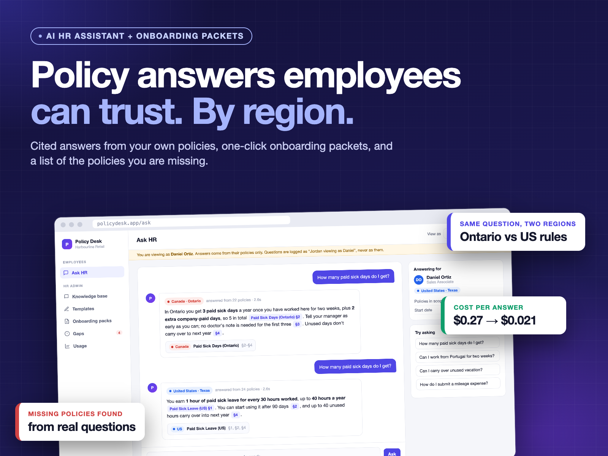](docs/media/demo.mp4)

▶ **[Watch the 65-second demo](docs/media/demo.mp4)** (with voiceover).

> Built for a retailer with employees in Canada and the US. The client's name, people and policies are private, so **this demo uses a fictional company ("Harbourline Retail") and sample policies**. The results quoted below are from the real system.

---

## The problem

HR answers the same questions every day: sick days, vacation, benefits, expenses, working abroad. Every new hire gets an onboarding packet assembled by hand from a dozen Word files. And when policies differ by province or state, it's easy to send someone the wrong one.

## What it does

| | |
|---|---|
| **Ask HR** | Employees ask in plain English. Answers come only from the company's policies, with the section cited. When no policy covers the question, it says so instead of guessing. |
| **By region** | Every policy is tagged Canada, US, contractors or all staff. Each employee is answered from their own set, so the same question gets the Ontario answer for one person and the US answer for another. |
| **View as** | HR can see exactly what any employee would see. Questions asked while viewing are logged as "HR viewing as X", never as the employee. |
| **Knowledge base** | One copy of each policy feeds both the assistant and the packets, so a policy edited once is correct everywhere. Paste from Word with formatting kept, full version history. |
| **Offer letter + packet** | Templates with merge fields (name, role, salary, start date, manager). One click builds the full onboarding packet as a branded PDF with only the policies that apply to that hire, in the right order. |
| **Gaps** | Questions the assistant couldn't answer, grouped by topic and counted, which makes them a ready-made list of policies to write. |
| **Usage** | Questions, citation rate, answer time and cost per question. |

<p align="center">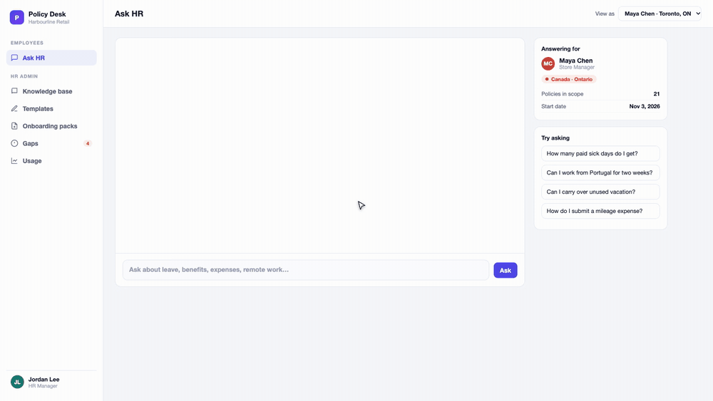 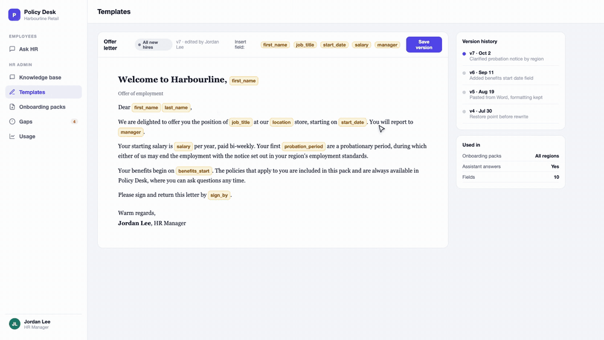</p>

## Results from the real system

- **Cost per question went from $0.27 to $0.021.** Prompt caching only matches an exact prefix. The first version put the employee's name in the system prompt, ahead of about 42,000 tokens of policies, so every person got a different prompt and paid full price. Moving "who is asking" after the policies let everyone share one cached prompt.
- **The generated packet matched HR's hand-built packet page for page**, on all 14 shared documents. The comparison also showed five documents had been in the wrong order for months. Getting the layout identical meant reading the font defaults from the Word files themselves, because the converter dropped them and every paragraph reflowed.
- **US hires had been getting Ontario rules.** Four policies written around Ontario law were tagged "all staff". The wording was fine; the targeting wasn't. Tagging by region fixed both the answers and the packets.
- **The unanswered questions revealed missing policies.** Two of the most-asked topics, vacation and statutory holidays, had no policy at all.

## Screens

| | |
|---|---|
| 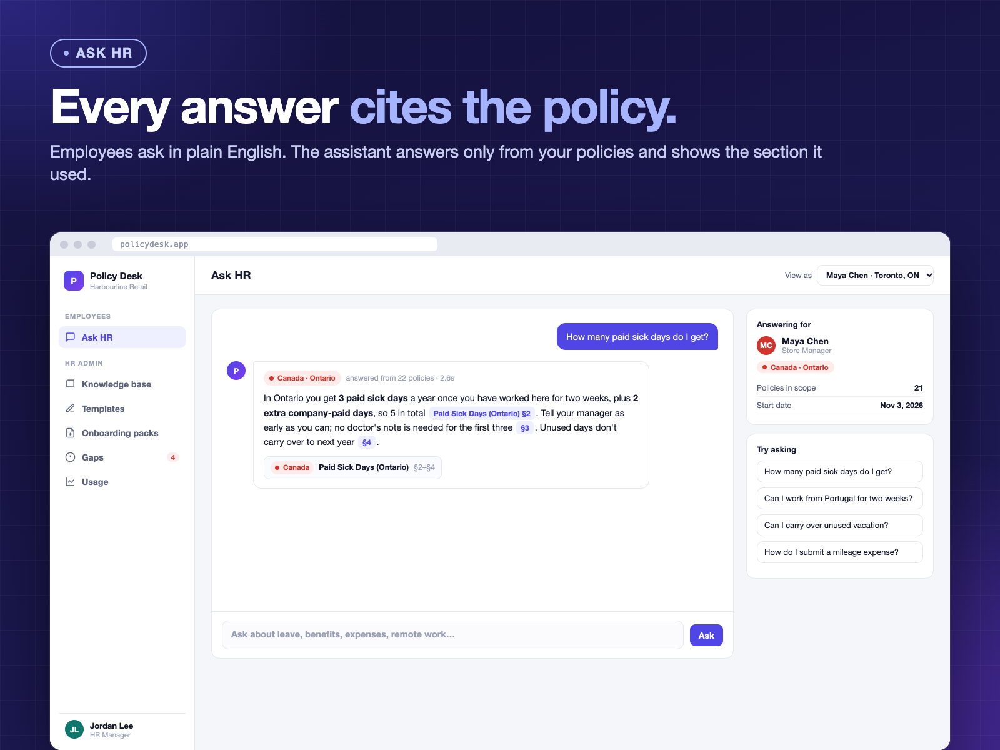 | 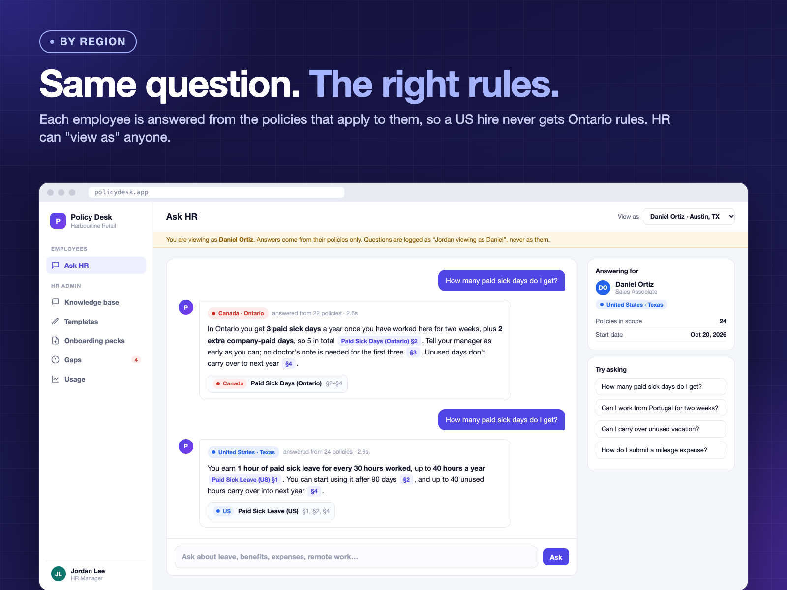 |
| 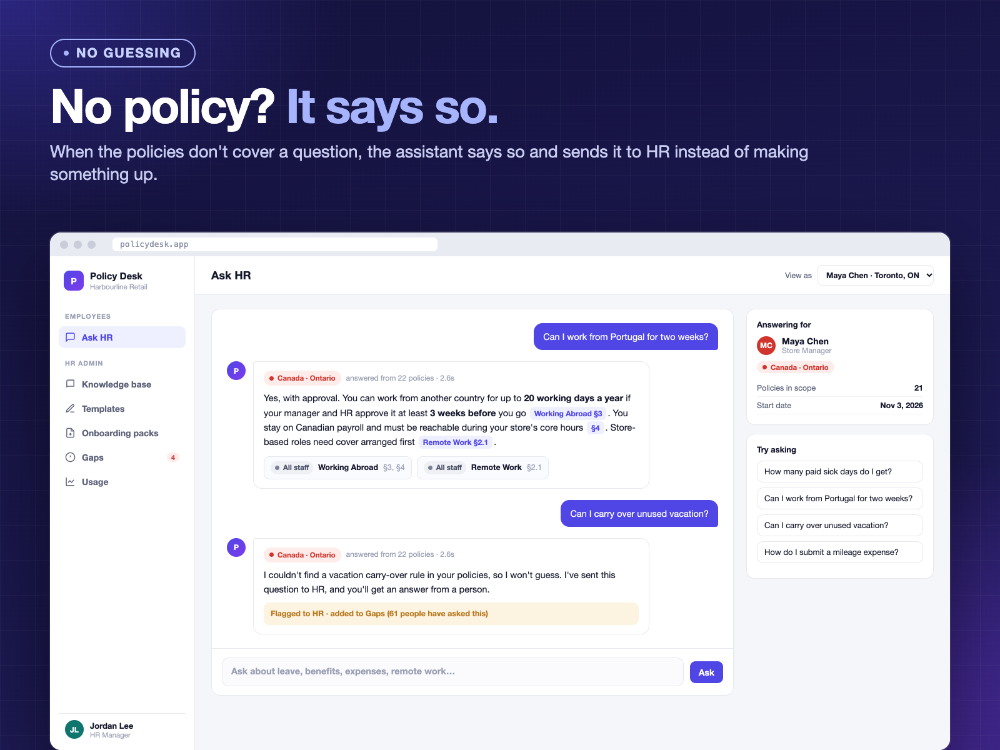 | 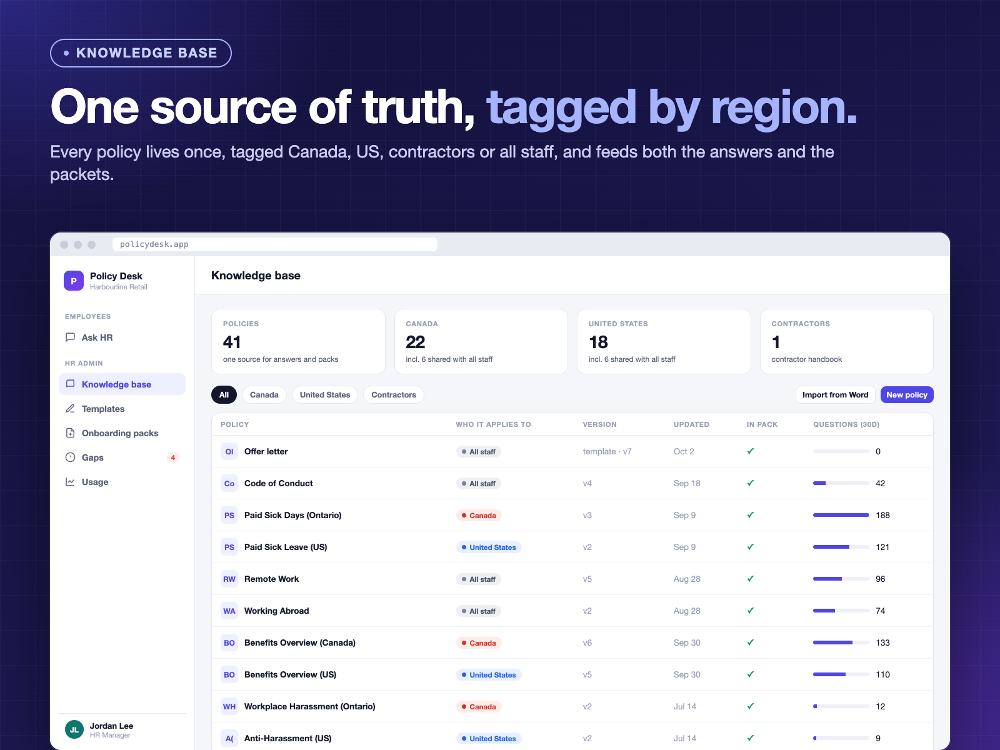 |
| 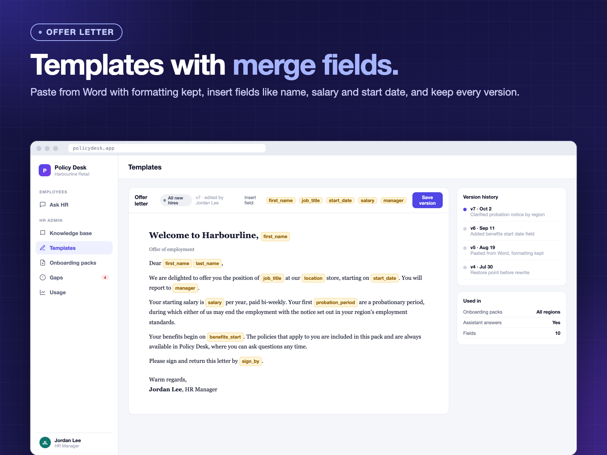 | 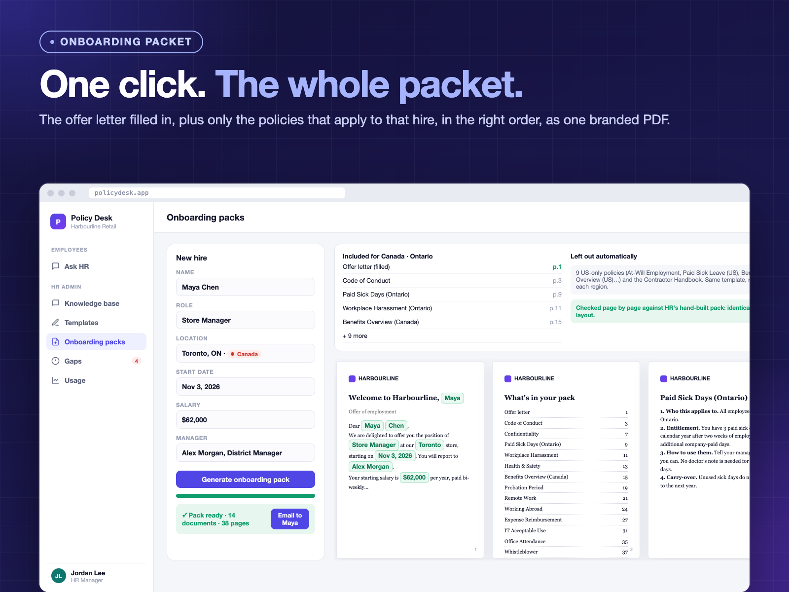 |
| 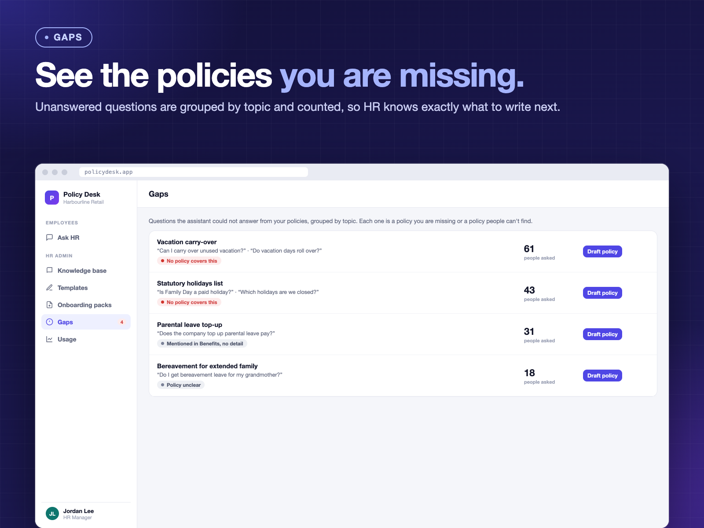 | 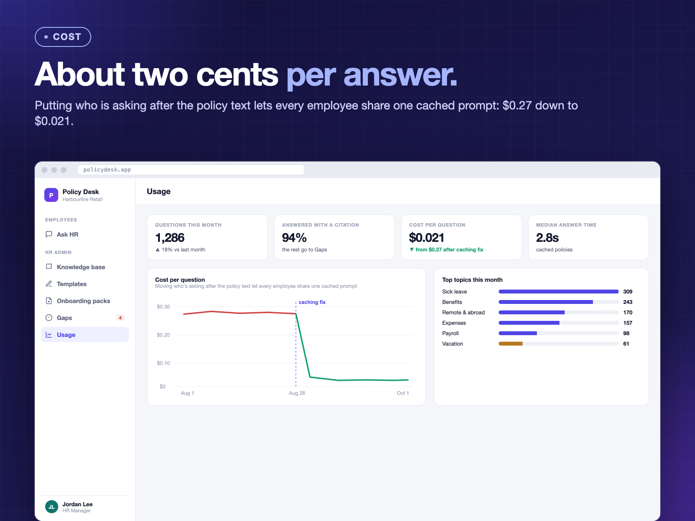 |

---

## How the production version works

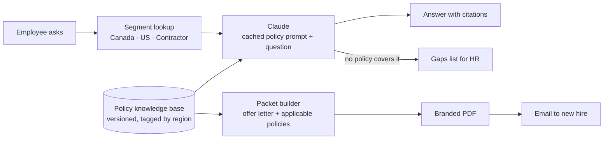

- **Python + FastAPI on AWS App Runner**, DynamoDB for people, documents, versions, audit and usage, Amazon SES for email, Claude API with prompt caching.
- **Answers and packets render from the same policy body**, so what the assistant quotes is exactly what the new hire receives.
- **Email + password sign-in, role checks on the server**, and an audit trail for every edit and every "view as".

### A lesson worth sharing
**Measure answerability; don't infer it from overlap.** Two employee handbooks looked fully redundant: every sentence existed in another policy. Removing them still dropped answer coverage by 5 points, because a sentence being *present* somewhere doesn't mean the assistant can *find* it. Extracting the handbook's table of contents as a policy index restored it.

---

## Try the demo

This repo contains the interface with sample data: a single HTML file, no build step.

```bash
git clone https://github.com/nigamgoyal/policy-desk.git
cd policy-desk/app
python3 -m http.server 8000
# open http://localhost:8000
```

Try asking "How many paid sick days do I get?", then switch **View as** to Daniel (US) and ask again. Then open **Onboarding packs** and click **Generate**.

The answers in the demo are pre-written for the sample questions. The production system generates them live from the client's policies, and its code is not published here.

---

Built by **[Nigam Goyal](https://github.com/nigamgoyal)**, Growbiz Solutions: AI and CRM automation. Running HR across provinces or states? Open an issue or reach out on LinkedIn.

*Harbourline Retail and everyone in this demo are fictional.*
